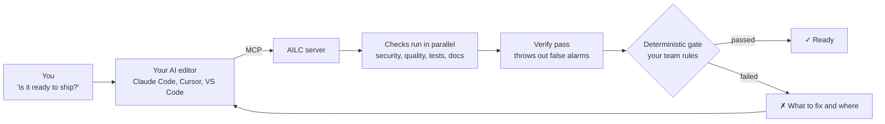
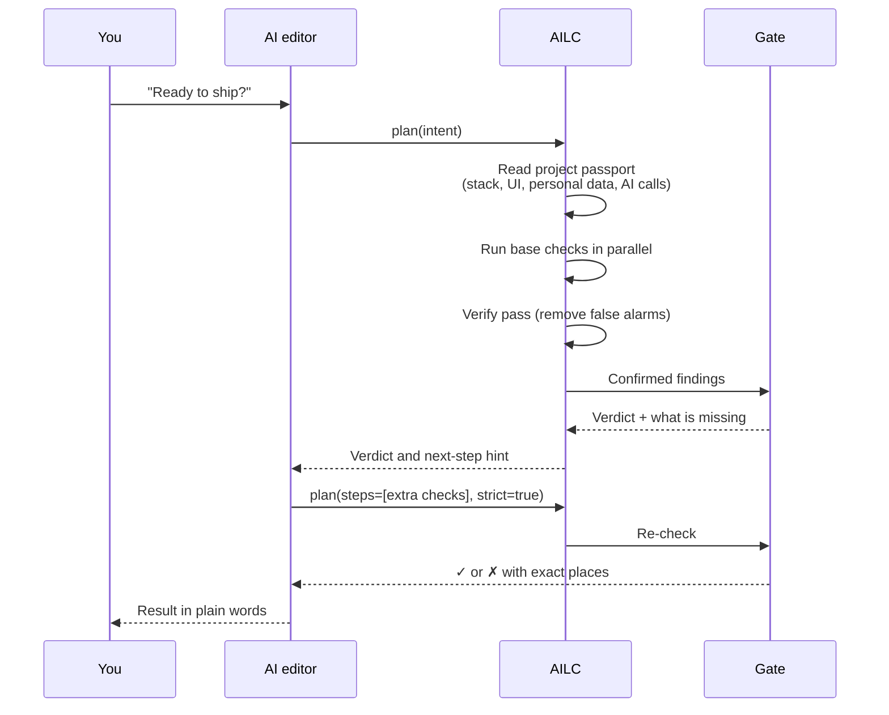
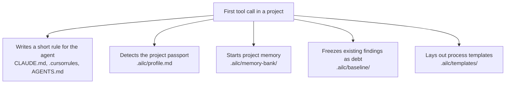
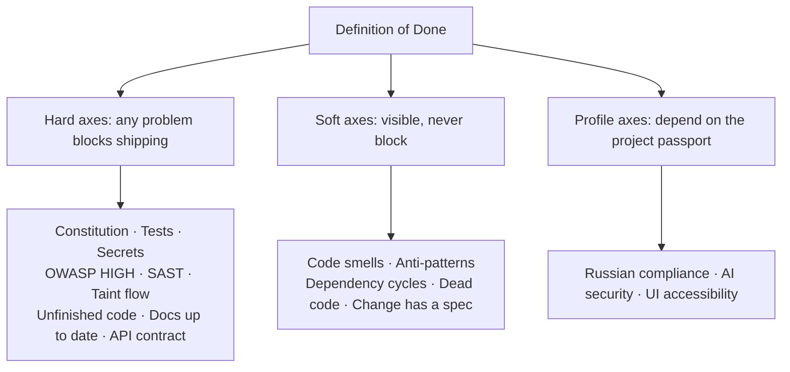
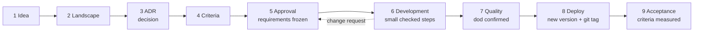
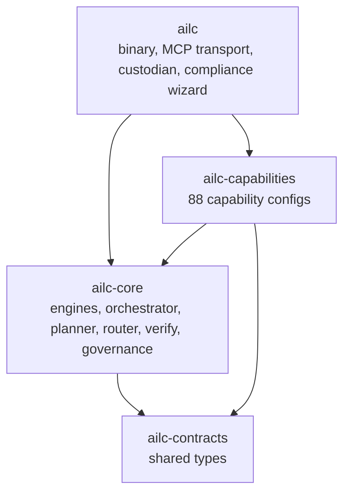

# AILC (AI Life Cycle)

**English** | [Русский](README.ru.md)

**AILC checks the quality and security of your code automatically, so you do not need to be an expert.** You say in plain words what you want ("is everything ready to ship?"), and AILC decides which checks to run, runs them, safely fixes formatting and lint, keeps documentation in sync with the code, and gives you a clear verdict. You are asked only about decisions that really need a human.

The most important idea: **the verdict comes from a deterministic gate, not from a neural network.** The AI helps plan and explain, but whether your code passes is decided by fixed, repeatable rules. The same code always gets the same answer.

AILC is a single Rust binary. It works fully offline: language grammars and a vulnerability database are built into it, and it needs no external services.

## Contents

[AILC in one picture](#ailc-in-one-picture) · [Get started in 5 minutes](#get-started-in-5-minutes) · [How it works](#how-it-works) · [Reading the verdict](#reading-the-verdict) · [The delivery process](#the-delivery-process) · [Commands](#commands) · [MCP tools](#mcp-tools) · [What it checks](#what-it-checks) · [Team rules (governance)](#team-rules-governance) · [Installation options](#installation-options) · [Architecture](#architecture) · [Honest limitations](#honest-limitations) · [Tests and CI](#tests-and-ci) · [License](#license)

## AILC in one picture



You talk to your AI editor as usual. The editor calls AILC through MCP (Model Context Protocol, the standard way editors connect to tools). AILC runs the checks, removes false alarms, and the gate gives the final answer. If something is wrong, the editor gets an exact list (file, line, reason) and can fix it, then check again.

## Get started in 5 minutes

**Step 1. Connect AILC to your editor.** For Claude Code, run one command (Node.js is required):

```sh
claude mcp add ailc -- npx -y ailc-mcp
```

For Cursor or VS Code, one-click links: [Add to Cursor](https://cursor.com/install-mcp?name=ailc&config=eyJjb21tYW5kIjoibnB4IiwiYXJncyI6WyIteSIsImFpbGMtbWNwIl19) · [Add to VS Code](https://vscode.dev/redirect/mcp/install?name=ailc&config=%7B%22type%22%3A%22stdio%22%2C%22command%22%3A%22npx%22%2C%22args%22%3A%5B%22-y%22%2C%22ailc-mcp%22%5D%7D). No Node.js? See [Installation options](#installation-options).

**Step 2. Ask in plain words.** In the editor chat write, for example:

> Check with ailc: is everything ok before I ship?

The editor calls the `plan` tool, and AILC does the rest.

**Step 3. Read the verdict.** You get a list of axes with ✓ or ✗ and, for every problem, a file, a line and a short explanation. Fix what is marked, or ask the editor to fix it, and ask again.

**Prefer the terminal?** The same checks without any AI:

```sh
ailc dod .     # "Is it done?" verdict for the current folder
ailc pulse .   # one-line status: ✅ quality 92/100 · blockers 0 · warnings 3 · checks 28
ailc fix .     # safely fix formatting and lint
```

**Something does not work?** Run `ailc doctor`. It shows where the binary is, whether `npx` is visible, whether the server is registered in your editor configs, and prints a ready-made config snippet for your setup.

## How it works

### The adaptive loop

When you call `plan`, AILC does not run everything blindly. It builds a plan from your intent and your project, runs it, looks at the result, and adds more checks only if they are needed.



There are two modes, and you do not have to choose: AILC detects it.

If the editor supports *sampling* (the server may ask the editor's model questions), AILC drives the whole loop itself: it asks the model which checks to run, runs them, and asks whether more are needed, for up to four rounds.

If the editor does not support sampling (Claude Code, for example), the roles swap: the editor's own model plans and reflects, passing check IDs in `steps`, and AILC runs checks, filters false alarms and applies the gate.

In both modes the final verdict comes from the gate, never from the model. If the model gives no usable plan, AILC falls back to a safe default set (security, quality, spec), adjusted to your project.

### What happens on the first call



All of this is idempotent (safe to repeat) and happens only on a real tool call, never just because the server was connected.

The **rule for the agent** tells your editor's AI to call `plan` before writing code and before saying "done". Disable it with `AILC_NO_RULES`.

The **project passport** records your stack, whether there is a UI or a mobile part, signs of personal data, a Russian-language codebase and calls to AI models. The passport changes how strict the verdict is: a project with a UI gets an accessibility axis, a project that calls AI models gets a mandatory AI-security axis.

The **project memory** is a journal of every tool call plus the current context, so a new session can catch up quickly.

The **baseline** solves the "legacy project" problem. Old findings are recorded as historical debt, and from then on only *new* findings block shipping. The debt stays visible as a separate number. Tests, lint and the API contract are never hidden as debt. Disable it with `AILC_NO_BASELINE`.

### Why there are few false alarms

Every finding goes through a **verify pass** that actively tries to disprove it: a "secret" that is really in a comment, a placeholder value, a safely configured XML parser, the rule's own definition, or a line marked `ailc:ignore`. Only findings that are confirmed and tied to a file and line affect the score and can block shipping.

The verifier also learns from your project: a rule whose findings are almost always disproved here (at least 20 observations, at least 80 percent disproved) is downgraded to a warning, with a visible note. Security-critical rules are excluded from this.

## Reading the verdict

`ailc dod .` (or the `dod` tool) answers the question "is this done?" along several axes.



The verdict is honest and has three states, not two:

| State | Meaning |
|---|---|
| **Confirmed** ✓ | Every hard axis really ran and found no blocking problem. |
| **Failed** ✗ | At least one hard axis found a blocking problem. The output says where. |
| **Not confirmed** | A hard axis did not run or had nothing to check. An empty repository never gets a green verdict "for free". |

The profile axes work like this. *Russian compliance* is soft by default (legal risk is heuristic, a lawyer decides), but becomes hard for a Russian-language project with signs of personal data. *AI security* appears only if the project calls AI models, and it is hard. *UI accessibility* appears only if the project has an interface, and it stays soft.

For CI, `ailc sarif . > results.sarif` produces a SARIF 2.1.0 report for the security tab of GitHub or GitLab. It also includes a *Rigor Score*: the share of checks that really ran out of those attempted.

## The delivery process

For larger work AILC can guide a project through nine stages. Each move forward is allowed only by the gate, so a stage cannot be skipped by accident.



You always know where you are: `.ailc/process/NEXT.md` says in one line what is needed from a human right now, and the state lives in `.ailc/process/state.toml`.

The gate checks concrete things before each move: required template sections are filled in, criteria are measurable, plan steps are closed, `dod` is confirmed, the version is new and has a git tag, acceptance passed. After **approval** (`action=approve`) the ADR (Architecture Decision Record) becomes "accepted" and the requirements are frozen by a sha256 hash. Anything new after that is a **change request** (`action=change`), which sends the process back to stage 5. Other returns use `action=return` with cycle А, В or Г (Cyrillic letters, as in the stage cards).

Development happens in **small steps** (`plan_add`, `step_begin`, `step_done`). Each step must have a `check` (a command or `cap:<id>`), and AILC closes a step only when that check passes.

**If the session breaks**, nothing is lost. AILC journals before and after each step in `.ailc/process/journal.md`, and `action=resume` returns a compact restart package (6000 tokens by default): current stage, interrupted step, uncommitted changes, decisions made, the stage card and one next action. `ailc stage hooks` prints a Claude Code hook config that calls `resume` at the start of every session and `status` on every message.

Templates (brief, landscape, ADR, `acceptance.toml`, change request, plan step, nine stage cards) are placed in `.ailc/templates/` and adapted to the project passport. Your team's edits are never overwritten; a newer built-in version is saved next to it with a `.new` extension.

The same is available from the command line: `ailc stage <action> [path] [key=value ...]`.

## Commands

All modes are subcommands of one binary.

```sh
ailc serve                         # MCP server over stdio (for your editor)
ailc <path> "I want to ship a feature"   # one-off run by intent (needs the editor's LLM)
ailc dod <path>                    # Definition of Done: multi-axis ✓/✗ verdict
ailc pulse <path>                  # quick one-line status (no tests or lint)
ailc sarif <path> > out.sarif      # SARIF 2.1.0 report for CI
ailc fix <path>                    # safe formatting and lint fixes (built-in fixers)
ailc design "<feature>" <path>     # feature design: spec draft and ADR
ailc stage <action> [path] [k=v]   # delivery process: status, advance, resume, ...
ailc cap <id> <path> [query]       # run a single tool (for debugging)
ailc skills [folder]               # export capabilities as an agentskills pack
ailc custodian <path> [sec] [--fix] [--once]   # continuous background watch
ailc custodian install <path> [sec]            # autostart via launchd (macOS)
ailc compliance-ru [folder]        # interactive Russian compliance wizard
ailc doctor [path]                 # connection diagnostics and config snippets
ailc baseline <path>               # freeze current findings as debt
```

Examples:

```sh
ailc cap security.scan/secret .    # only look for hardcoded secrets
ailc cap code.intel/surface .      # list endpoints, env variables and services
```

## MCP tools

The server exposes **eight front-door tools**. The full catalog of 88 capabilities sits behind them, so your editor's context is not flooded.

| Tool | Input | What it does |
|---|---|---|
| `plan` | `intent` (required), `path`, `steps`, `strict` | The adaptive loop by intent: plan, run, verify, reflect, gate. Returns a `QualityLedger`. Works with any client. |
| `find_capability` | `query` (optional) | Finds the right tool using a synonym dictionary ("holes" means vulnerabilities, "slow" means performance). When unsure, returns the whole catalog so the editor's model can choose. |
| `run` | `id` (required), `path`, `target`, `query` | Runs one tool by ID and returns its findings. No LLM. |
| `autofix` | `path`, `max` (default 8) | LLM fixes formatting and lint, then the same detector re-checks the file; a fix is kept only if the finding is gone and nothing new appeared. Needs sampling; otherwise use `ailc fix`. |
| `dod` | `path` | Deterministic "is it done?" verdict. No LLM. |
| `sarif` | `path` | Full scan and SARIF 2.1.0 report. No LLM. |
| `design` | `feature` (required), `path` | Spec draft and an ADR for a new feature. |
| `stage` | `action`, `path`, `reason`, `cycle`, `version`, `step` and others | The nine-stage delivery process and work plan. |

Responses contain human-readable `content` and, where useful, typed JSON in `structuredContent`. Supported protocol versions: `2024-11-05`, `2025-03-26`, `2025-06-18`.

`ailc skills [folder]` exports all capabilities as an [agentskills.io](https://agentskills.io) compatible pack (`.claude-plugin/plugin.json` plus one `SKILL.md` per tool), installable as a Claude Code plugin.

## What it checks

The 88 capabilities are grouped into families. Each one is a thin config over a shared engine, so logic is never duplicated.

**Security.** Hardcoded secrets (28 rules: AWS, GitHub, Stripe, GCP, Azure, Slack, LLM provider keys, private keys, connection strings, high-entropy strings). Structural analysis on the syntax tree (SAST, Static Application Security Testing). Inter-procedural taint analysis in 15 languages. OWASP Top 10 categories. Personal data in code and logs. Web and API vulnerabilities. Docker, Kubernetes and Terraform. Shell scripts. CI workflows (untrusted input in commands, `pull_request_target` misuse, unpinned actions, leaked secrets). Dependencies against a built-in offline OSV vulnerability snapshot. Copyleft licenses. OWASP LLM Top 10 for AI code (prompt injection, unsafe handling of model output, sensitive data in prompts, excessive agent permissions).

**Taint analysis in detail.** It follows untrusted input from a source through assignments and function calls to a dangerous sink, taking sanitizers into account. Languages: Python, JavaScript, TypeScript, Go, Java, Ruby, PHP, C#, Rust, Kotlin, Scala, C, C++, Swift, Dart. Sinks: command execution (CWE-78, CWE-94), SQL injection (CWE-89), path traversal (CWE-22), XSS (CWE-79), LDAP and XPath injection (CWE-90, CWE-643), open redirect (CWE-601), trust boundary (CWE-501). For C and C++ also buffer overflow, format string, integer overflow, use-after-free and double free. A sanitizer counts only if its class matches the sink class.

**Quality.** Code smells, dead code, dependency cycles, anti-patterns (huge files, deep nesting), complex functions, architecture rules from `.ailc/constitution.md`, layer violations, undocumented public API, unfinished code (stubs, empty handlers), and UI accessibility by WCAG 2.1 for web, Android, iOS and Flutter.

**Code intelligence.** Symbols, module cards, call graph, project map, find usages, lexical search, extracted surface (HTTP endpoints, env variables, databases, queues, data models), Mermaid module diagram, blast radius of the current change, size and complexity metrics.

**Verification by running.** `verify/test` detects the stack (Rust, Go, Node, Python, Scala, Gradle, Maven, Swift, Dart, Ruby, PHP, C and C++, .NET) and runs the tests. Also lint, coverage, "does this symbol exist" (protection against model hallucinations), API breaking changes against a snapshot, mobile and desktop configs.

**Generation** (writes files idempotently). Documentation, diagrams, full documents by standard (GOST 19.201-78, GOST 34.602-2020, GOST 19.404-79, GOST R 59795-2021, arc42, C4), data model, glossary, API snapshot, SBOM in CycloneDX, release notes, ADR, spec drift check, task journal.

**Russian compliance.** Personal data (passport, SNILS, INN) in logs (152-FZ), storage abroad (242-FZ), foreign trackers (152-FZ art. 12), pre-filled consent (152-FZ art. 9), foreign cryptography on critical infrastructure (187-FZ, enterprise tier). These are **review signals, not a legal guarantee**.

**Languages and ecosystems.** Deep analysis in 15 languages via built-in `tree-sitter` grammars, with a regex fallback if parsing fails. Offline dependency checks for 12 lock-file formats: `requirements.txt`, `poetry.lock`, `Pipfile.lock`, `Cargo.lock`, `package-lock.json`, `yarn.lock`, `pnpm-lock.yaml`, `go.sum`, `gradle.lockfile`, `pubspec.lock`, `Podfile.lock`, `composer.lock`. An ecosystem with no data is reported as "not covered", which is not the same as "clean".

The OSV snapshot is built from official OSV.dev exports by `tools/update-osv.py`, stored as text in `crates/ailc-core/assets/osv/snapshot.tsv`, compressed into the binary (about 1.5 MB) and refreshed weekly by `.github/workflows/osv-update.yml`. Malicious-package records (`MAL-*`) are left out on purpose because of their volume; for those, and for the very latest records, run your ecosystem's auditor (`cargo audit`, `npm audit`, `pip-audit`, `osv-scanner`). AILC picks up its results when it is installed.

## Team rules (governance)

A senior engineer puts `ailc.policy.toml` in the project root once; juniors configure nothing, the gate applies the rules.

```toml
name = "my-org"

[gate]
block_at = "high"                  # info | low | medium | high | critical
families  = ["security", "quality", "spec", "verify"]

[thresholds]
score_critical    = 25.0           # penalty per critical finding
score_high        = 10.0
score_medium      = 3.0
score_low         = 1.0
score_info        = 0.2
max_defs_per_file = 30             # "god file" threshold
max_nesting       = 6
doc_coverage_floor = 50.0          # percent of public API documented
max_lines         = 400
max_complexity    = 50
semantic_threshold = 0.62
```

Trust has three layers. The organization default is built into the code. If the project file is weaker (blocks less, skips families, lowers penalties), the gate shows a visible warning. A trusted reference file can be set with `AILC_POLICY` and pinned with `AILC_POLICY_SHA256`. A broken or tampered file is never silently accepted: the default is applied with an explicit warning.

**Architecture rules in one sentence.** Rules live in `.ailc/constitution.md` as `FORBID`, `REQUIRE` and `REQUIRE_EACH` lines, with optional `[warn]`, `[in: path]` and a `# reason`. You can add one in plain words, and AILC translates it deterministically, without a network: "forbid `console.log` in src because it is debug output" becomes `FORBID [in: src] console.log # because it is debug output`. AILC immediately reports how many places in the code break the new rule. An unrecognized sentence is rejected clearly instead of being guessed.

**Decision journal.** A new ADR is born "proposed"; accepting it is a separate human action. "Move to ClickHouse, replaces ADR-1" creates a new record and marks the old one "superseded" with links both ways. `verify/adr-lifecycle` checks the journal for missing or unknown statuses and broken links.

**Thresholds adapt to the repository.** Structural thresholds (long file, god file, complex function, nesting) are stricter on a small young project and softer on a large mature one, within a narrow fixed range. The blocking level and score weights are never auto-calibrated, and thresholds set by a human are never touched. Disable with `AILC_NO_CALIBRATION`.

## Continuous watch (custodian)

`ailc custodian <path> [sec] [--fix] [--once]` watches for changes, runs fast deterministic checks, fixes formatting and lint with `--fix`, updates docs and alerts a human. Status goes to `.ailc/custodian/`, `ALERT.md` is surfaced in the editor chat, and macOS shows notifications. Stop it by creating `.ailc/custodian/STOP`. `ailc custodian install <path> [sec]` sets up autostart via `launchd` on macOS (every 15 minutes by default); `uninstall` removes it.

## Installation options

**Via npx (easiest with Node.js).** Put this in `.mcp.json` (Claude Code) or `~/.cursor/mcp.json` (Cursor). On first launch the `ailc-mcp` package downloads the right binary from the release:

```json
{ "mcpServers": { "ailc": { "command": "npx", "args": ["-y", "ailc-mcp"] } } }
```

Any subcommand works too, for example `npx -y ailc-mcp dod .`.

**Installer (no Node.js).** Detects your platform, downloads the binary, verifies its checksum and prints a config snippet.

macOS and Linux:

```sh
curl -fsSL https://raw.githubusercontent.com/pro-deploy/ailc/main/install.sh | sh
```

Windows (PowerShell):

```powershell
irm https://raw.githubusercontent.com/pro-deploy/ailc/main/install.ps1 | iex
```

Supported: Linux (x86_64, aarch64), macOS (Intel, Apple Silicon), Windows (x86_64). Override the install folder and version with `AILC_BINDIR` and `AILC_VERSION`.

**Connecting the binary directly.** Claude Code or Cursor:

```json
{ "mcpServers": { "ailc": { "command": "/path/to/ailc", "args": ["serve"] } } }
```

VS Code (GitHub Copilot agent mode) uses a different schema: open "MCP: Open User Configuration" from the command palette and add:

```json
{ "servers": { "ailc": { "type": "stdio", "command": "/absolute/path/to/ailc", "args": ["serve"] } } }
```

**A common pitfall:** if Node.js is installed via `nvm`, use the absolute path to the `ailc` binary instead of `npx`. Apps started from the Dock or a menu do not inherit the `nvm` PATH, so they cannot find `npx`. The installer prints the path (`~/.local/bin/ailc` by default).

**Prebuilt binaries** for all platforms are attached to every [release](https://github.com/pro-deploy/ailc/releases) together with a `.sha256` file. Releases are built by `.github/workflows/release.yml` when a `vX.Y.Z` tag is pushed.

**Building from source.** You need stable Rust (the version is pinned in `rust-toolchain.toml`):

```sh
cargo build --release              # produces target/release/ailc (about 31 MB)
./target/release/ailc dod .        # quick check
cargo test --workspace             # more than a thousand tests
```

The binary contains 15 `tree-sitter` grammars and the compressed OSV snapshot, so it needs no network at run time. There is no embedding model inside: tool selection uses a deterministic synonym match, and when unsure the whole catalog (about 20 KB) goes to the editor's model, which reads the answer anyway. The `release` profile is tuned for size and safety (`opt-level = "z"`, `lto = true`, `codegen-units = 1`, `panic = "unwind"` so that `catch_unwind` isolation works, `strip = true`).

## Architecture

A tool is a triple of family, engine and config. Engines are written once; capabilities are configs over them.



The nine engines: `Scan` (rule search and structural analysis), `CodeIntel` (extraction from the syntax tree), `Gate` (governance), `Runner` (external tools with a timeout), `Generator` (documents and diagrams), `Store` (records), `Metric` (metrics and trends), `Diagram` (model to Mermaid), `Index` (lexical index behind `code.intel/search`).

More detail (in Russian): [docs/АРХИТЕКТУРА.md](docs/АРХИТЕКТУРА.md), [docs/C4.md](docs/C4.md), [docs/РУКОВОДСТВО-ПОЛЬЗОВАТЕЛЯ.md](docs/РУКОВОДСТВО-ПОЛЬЗОВАТЕЛЯ.md), [docs/ГЛОССАРИЙ.md](docs/ГЛОССАРИЙ.md).

## Honest limitations

Automatic fixing is limited to formatting and lint; security and logic are decided by a human. Each pipeline step is limited to 180 seconds: a stuck check is marked as timed out instead of blocking the run. Paths from MCP input are validated and cannot escape the project root. Scanning a security tool's own files can produce self-matches, as with any scanner. Taint analysis is inter-procedural and flow-sensitive inside a function, but branches do not split the state (a conservative trade-off for fewer false alarms), and sanitizers from the curated list are treated as context-independent. Russian legal checks (152-FZ, 242-FZ, 187-FZ, GOST) are **signals for review, not a legal guarantee**. Things that are narrow or only scaffolded are listed in [ROADMAP.md](ROADMAP.md).

## Tests and CI

More than a thousand tests, including the taint matrix for 15 languages, the unfinished-code guard, documentation generation and drift, a false-positive regression corpus, project passport, debt baseline, server memory and verifier self-learning. CI (`.github/workflows/ci.yml`) builds release and runs the tests on every push and pull request; clippy runs as information only.

## License

The open core (analysis engine, CLI, local modes, editor integration) is licensed under **Apache 2.0** (see [LICENSE](LICENSE)). Enterprise and compliance modules (maintained compliance packs, enterprise control layer, attestation report) are under a separate commercial license and are not part of this repository.
