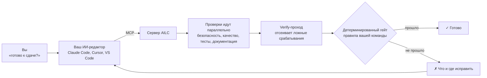
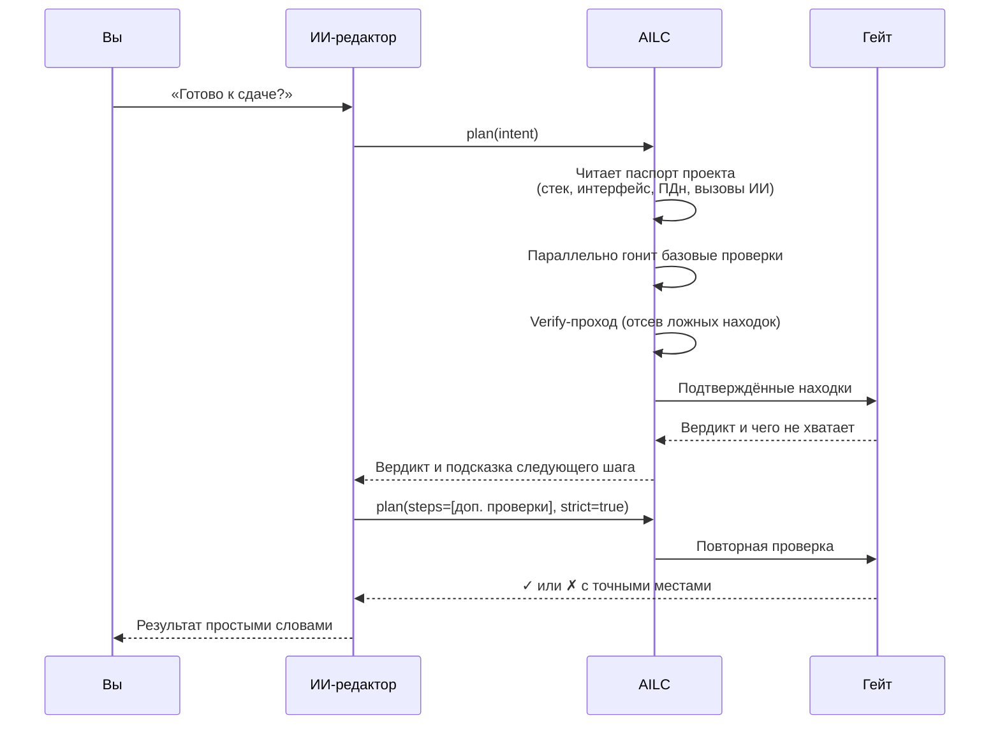
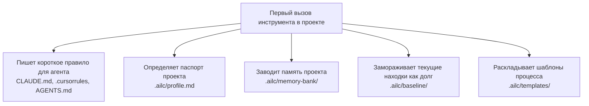
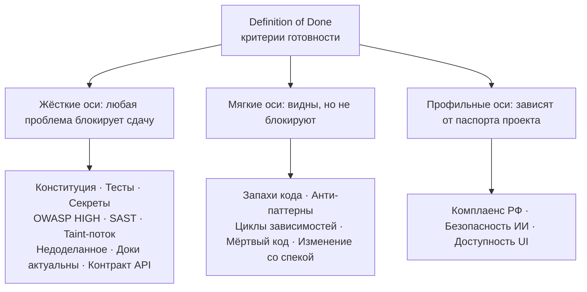
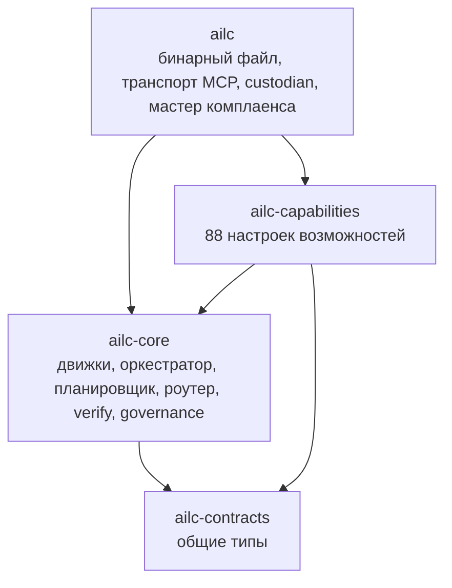

# AILC (AI Life Cycle)

[English](README.md) | **Русский**

**AILC автоматически проверяет качество и безопасность кода, и для этого не нужно быть экспертом.** Вы простыми словами говорите, чего хотите («всё ли готово к сдаче?»), а AILC сам решает, какие проверки нужны, запускает их, безопасно чинит формат и линт, поддерживает документацию в согласии с кодом и выносит понятный вердикт. Человека спрашивают только о тех решениях, которые действительно требуют человека.

Главная идея такова: **вердикт выносит детерминированный гейт, а не нейросеть.** Искусственный интеллект помогает планировать и объяснять, но прошёл ли код проверку, решают фиксированные воспроизводимые правила. Один и тот же код всегда получает один и тот же ответ.

AILC представляет собой один бинарный файл на Rust. Он работает полностью офлайн: грамматики языков и база уязвимостей встроены внутрь, внешние сервисы не нужны.

## Содержание

[AILC на одной схеме](#ailc-на-одной-схеме) · [Начало работы за 5 минут](#начало-работы-за-5-минут) · [Как это работает](#как-это-работает) · [Как читать вердикт](#как-читать-вердикт) · [Процесс поставки](#процесс-поставки) · [Команды](#команды) · [Инструменты MCP](#инструменты-mcp) · [Что проверяется](#что-проверяется) · [Правила команды (governance)](#правила-команды-governance) · [Варианты установки](#варианты-установки) · [Архитектура](#архитектура) · [Честные ограничения](#честные-ограничения) · [Тесты и непрерывная интеграция](#тесты-и-непрерывная-интеграция) · [Лицензия](#лицензия)

## AILC на одной схеме



Вы общаетесь со своим ИИ-редактором как обычно. Редактор вызывает AILC по протоколу MCP (Model Context Protocol, стандартный способ подключения инструментов к редакторам). AILC прогоняет проверки, убирает ложные срабатывания, и окончательный ответ даёт гейт. Если что-то не так, редактор получает точный список (файл, строка, причина), может это исправить и проверить снова.

## Начало работы за 5 минут

**Шаг 1. Подключите AILC к редактору.** Для Claude Code достаточно одной команды (нужен Node.js):

```sh
claude mcp add ailc -- npx -y ailc-mcp
```

Для Cursor и VS Code есть ссылки установки в один клик: [Добавить в Cursor](https://cursor.com/install-mcp?name=ailc&config=eyJjb21tYW5kIjoibnB4IiwiYXJncyI6WyIteSIsImFpbGMtbWNwIl19) · [Добавить в VS Code](https://vscode.dev/redirect/mcp/install?name=ailc&config=%7B%22type%22%3A%22stdio%22%2C%22command%22%3A%22npx%22%2C%22args%22%3A%5B%22-y%22%2C%22ailc-mcp%22%5D%7D). Если Node.js нет, смотрите раздел [Варианты установки](#варианты-установки).

**Шаг 2. Попросите простыми словами.** В чате редактора напишите, например:

> Проверь через ailc, всё ли в порядке перед сдачей?

Редактор вызовет инструмент `plan`, а остальное AILC сделает сам.

**Шаг 3. Прочитайте вердикт.** Вы получите список осей с отметками ✓ или ✗, а для каждой проблемы файл, строку и короткое объяснение. Исправьте отмеченное или попросите редактор сделать это, затем спросите ещё раз.

**Предпочитаете терминал?** Те же проверки работают без всякого искусственного интеллекта:

```sh
ailc dod .     # вердикт «готово ли?» для текущего каталога
ailc pulse .   # статус одной строкой: ✅ качество 92/100 · блокеров 0 · предупреждений 3 · проверок 28
ailc fix .     # безопасная починка формата и линта
```

**Что-то не заработало?** Запустите `ailc doctor`. Команда покажет, где лежит бинарный файл, виден ли `npx`, зарегистрирован ли сервер в конфигурациях редакторов, и напечатает готовый фрагмент настройки под вашу среду.

## Как это работает

### Адаптивная петля

При вызове `plan` AILC не запускает всё подряд. Он строит план по вашему намерению и по устройству проекта, выполняет его, смотрит на результат и довызывает проверки только тогда, когда они действительно нужны.



Режимов два, и выбирать между ними не нужно: AILC определяет режим сам.

Если редактор поддерживает *sampling* (сервер может задавать вопросы модели редактора), AILC целиком ведёт петлю сам: спрашивает модель, какие проверки запустить, выполняет их и спрашивает, нужны ли ещё, не более четырёх раундов.

Если редактор sampling не поддерживает (например, Claude Code), роли меняются местами: планирует и анализирует результат модель самого редактора, передавая идентификаторы проверок в параметре `steps`, а AILC выполняет проверки, отсеивает ложные находки и применяет гейт.

В обоих режимах окончательный вердикт выносит гейт, а не модель. Если модель не дала пригодного плана, AILC использует безопасный набор по умолчанию (безопасность, качество, спецификация), подстроенный под ваш проект.

### Что происходит при первом вызове



Все эти действия идемпотентны (их безопасно повторять) и выполняются только при реальном вызове инструмента, но не от одного лишь факта подключения сервера.

**Правило для агента** велит ИИ вашего редактора вызывать `plan` перед написанием кода и перед ответом «готово». Отключается переменной окружения `AILC_NO_RULES`.

**Паспорт проекта** фиксирует стек, наличие интерфейса и мобильной части, признаки персональных данных, русскоязычность кодовой базы и обращения к моделям ИИ. От паспорта зависит строгость вердикта: у проекта с интерфейсом появляется ось доступности, у проекта с вызовами моделей ИИ появляется обязательная ось безопасности ИИ.

**Память проекта** представляет собой журнал каждого вызова инструмента и текущий контекст, благодаря чему новая сессия быстро входит в курс дела.

**Базовая линия** решает проблему унаследованного проекта. Старые находки записываются как исторический долг, и с этого момента сдачу блокируют только *новые* находки. Долг остаётся виден отдельным показателем. Тесты, линт и контракт API под долг не попадают никогда. Отключается переменной окружения `AILC_NO_BASELINE`.

### Почему ложных срабатываний мало

Каждая находка проходит **verify-проход**, который активно пытается её опровергнуть: «секрет» на самом деле в комментарии, значение-заглушка, безопасно настроенный XML-парсер, строка с определением самого правила либо строка с пометкой `ailc:ignore`. На балл и на блокировку влияют только подтверждённые находки с привязкой к файлу и строке.

Верификатор также обучается на вашем проекте: правило, чьи находки здесь почти всегда опровергаются (не менее 20 наблюдений и не менее 80 процентов опровержений), понижается до предупреждения с видимой пометкой. Правила, критичные для безопасности, из этого механизма исключены.

## Как читать вердикт

`ailc dod .` (или инструмент `dod`) отвечает на вопрос «готово ли?» сразу по нескольким осям.



Вердикт честный, и у него три состояния, а не два:

| Состояние | Значение |
|---|---|
| **Подтверждён** ✓ | Каждая жёсткая ось действительно выполнилась и не нашла блокирующих проблем. |
| **Провален** ✗ | Хотя бы одна жёсткая ось нашла блокирующую проблему. В выводе указано, где именно. |
| **Не подтверждён** | Жёсткая ось не запускалась или ей было нечего проверять. Пустой репозиторий никогда не получает зелёный вердикт без оснований. |

Профильные оси устроены так. Ось *Комплаенс РФ* по умолчанию мягкая (юридические риски определяются эвристически, решение остаётся за юристом), но становится жёсткой у русскоязычного проекта с признаками персональных данных. Ось *Безопасность ИИ* появляется только у проекта с обращениями к моделям ИИ и сразу жёсткая. Ось *Доступность UI* появляется только у проекта с интерфейсом и остаётся мягкой.

Для непрерывной интеграции команда `ailc sarif . > results.sarif` формирует отчёт SARIF 2.1.0 для вкладки безопасности GitHub или GitLab. В нём также есть показатель *Rigor Score*: доля реально выполненных проверок среди попытанных.

## Процесс поставки

Для крупной работы AILC может провести проект через девять этапов. Каждый переход вперёд разрешает только гейт, поэтому этап невозможно пропустить случайно.


Работа не теряется между сессиями: файл `.ailc/process/NEXT.md` служит передачей работы агенту ИИ в новой сессии. ailc обновляет его при каждом событии процесса, и в нём собрано всё для продолжения: этап, прерванный шаг, заметки модели из `.ailc/memory-bank/`, принятые решения, последние события из единого журнала `.ailc/process/journal.md` и следующее действие. Первая строка файла говорит, что сейчас требуется от человека. Состояние процесса хранится в `.ailc/process/state.toml`.

Перед каждым переходом гейт проверяет конкретные условия: обязательные разделы шаблонов заполнены, критерии измеримы, шаги плана закрыты, `dod` подтверждён, версия новая и имеет git-тег, приёмка пройдена. После **согласования** (`action=approve`) запись архитектурного решения ADR (Architecture Decision Record) получает статус «принято», а требования замораживаются по хешу sha256. Всё новое после этого оформляется **запросом на изменение** (`action=change`), который возвращает процесс на этап 5. Прочие возвраты выполняются через `action=return` с циклом А, В или Г.

Разработка ведётся **мелкими шагами** (`plan_add`, `step_begin`, `step_done`). У каждого шага обязательна проверка `check` (команда или `cap:<id>`), и AILC закрывает шаг, только когда эта проверка проходит.

**Если сессия оборвалась**, ничего не теряется. AILC пишет журнал до и после каждого шага в `.ailc/process/journal.md`, а `action=resume` возвращает компактный пакет возобновления (по умолчанию 6000 токенов): текущий этап, прерванный шаг, незакоммиченные изменения, принятые решения, карточку этапа и одно следующее действие. Команда `ailc stage hooks` печатает настройку хуков Claude Code, которая вызывает `resume` в начале каждой сессии и `status` на каждое сообщение.

Шаблоны (бриф, ландшафт, ADR, `acceptance.toml`, запрос на изменение, шаг плана и девять карточек этапов) раскладываются в `.ailc/templates/` и подстраиваются под паспорт проекта. Правки вашей команды никогда не перезаписываются: новая встроенная версия кладётся рядом с расширением `.new`.

То же самое доступно из командной строки: `ailc stage <действие> [путь] [ключ=значение ...]`.

## Команды

Все режимы вызываются подкомандами одного бинарного файла.

```sh
ailc serve                         # MCP-сервер поверх stdio (для редактора)
ailc <путь> "хочу выкатить фичу"   # разовый прогон по намерению (нужна LLM редактора)
ailc dod <путь>                    # Definition of Done: многоосевой вердикт ✓/✗
ailc pulse <путь>                  # быстрый статус одной строкой (без тестов и линта)
ailc sarif <путь> > out.sarif      # отчёт SARIF 2.1.0 для непрерывной интеграции
ailc fix <путь>                    # безопасная починка формата и линта (встроенные фиксеры)
ailc design "<фича>" <путь>        # проектирование фичи: заготовка спеки и ADR
ailc stage <действие> [путь] [к=з] # процесс поставки: status, advance, resume и другие
ailc cap <id> <путь> [query]       # прогнать один инструмент (для отладки)
ailc skills [папка]                # экспорт возможностей как пак навыков agentskills
ailc custodian <путь> [сек] [--fix] [--once]   # непрерывный фоновый присмотр
ailc custodian install <путь> [сек]            # автозапуск через launchd (macOS)
ailc compliance-ru [папка]         # интерактивный мастер комплаенса РФ
ailc doctor [путь]                 # диагностика подключения и готовые фрагменты настройки
ailc baseline <путь>               # заморозить текущие находки как долг
```

Примеры:

```sh
ailc cap security.scan/secret .    # только поиск захардкоженных секретов
ailc cap code.intel/surface .      # список эндпоинтов, переменных окружения и сервисов
```

## Инструменты MCP

Сервер отдаёт наружу **восемь основных инструментов**. Полный каталог из 88 возможностей скрыт за ними, поэтому контекст редактора не переполняется.

| Инструмент | Вход | Назначение |
|---|---|---|
| `plan` | `intent` (обязательно), `path`, `steps`, `strict` | Адаптивная петля по намерению: план, исполнение, verify, рефлексия, гейт. Возвращает `QualityLedger`. Работает с любым клиентом. |
| `find_capability` | `query` (необязательно) | Подбирает нужный инструмент по словарю синонимов («дыры» означают уязвимости, «медленно» означает производительность). При неуверенности отдаёт весь каталог, чтобы выбрала модель редактора. |
| `run` | `id` (обязательно), `path`, `target`, `query` | Выполняет один инструмент по идентификатору и возвращает находки. Без LLM. |
| `autofix` | `path`, `max` (по умолчанию 8) | LLM чинит формат и линт, затем тот же детектор перепроверяет файл; правка сохраняется, только если находка исчезла и новых не появилось. Требует sampling, иначе используйте `ailc fix`. |
| `dod` | `path` | Детерминированный вердикт «готово ли?». Без LLM. |
| `sarif` | `path` | Полный скан и отчёт SARIF 2.1.0. Без LLM. |
| `design` | `feature` (обязательно), `path` | Заготовка спецификации и ADR для новой фичи. |
| `stage` | `action`, `path`, `reason`, `cycle`, `version`, `step` и другие | Процесс поставки из девяти этапов и план работ. |

Ответы содержат человекочитаемое поле `content` и, где это полезно, типизированный JSON в поле `structuredContent`. Поддерживаемые версии протокола: `2024-11-05`, `2025-03-26`, `2025-06-18`.

Команда `ailc skills [папка]` выгружает все возможности как пак, совместимый со стандартом [agentskills.io](https://agentskills.io) (файл `.claude-plugin/plugin.json` и по одному `SKILL.md` на инструмент), который ставится как плагин Claude Code.

## Что проверяется

88 возможностей сгруппированы по семействам. Каждая из них представляет собой тонкую настройку над общим движком, поэтому логика нигде не дублируется.

**Безопасность.** Захардкоженные секреты (28 правил: AWS, GitHub, Stripe, GCP, Azure, Slack, ключи провайдеров LLM, приватные ключи, строки подключения, строки с высокой энтропией). Структурный анализ по синтаксическому дереву SAST (Static Application Security Testing, статическое тестирование безопасности приложений). Межпроцедурный анализ заражения на 15 языках. Категории OWASP Top 10. Персональные данные в коде и журналах. Уязвимости веба и API. Docker, Kubernetes и Terraform. Командные сценарии. Рабочие процессы непрерывной интеграции (недоверенный ввод в командах, неверное использование `pull_request_target`, незафиксированные действия, утечка секретов). Зависимости по встроенному офлайн-снимку базы уязвимостей OSV. Лицензии copyleft. OWASP LLM Top 10 для кода с ИИ (инъекция в подсказку, небезопасная обработка вывода модели, чувствительные данные в подсказке, избыточные полномочия агента).

**Анализ заражения подробнее.** Он прослеживает недоверенный ввод от источника через присваивания и вызовы функций до опасного стока с учётом санитайзеров. Языки: Python, JavaScript, TypeScript, Go, Java, Ruby, PHP, C#, Rust, Kotlin, Scala, C, C++, Swift, Dart. Стоки: исполнение команды (CWE-78, CWE-94), внедрение в SQL (CWE-89), обход пути (CWE-22), межсайтовый скриптинг XSS (CWE-79), внедрение в LDAP и XPath (CWE-90, CWE-643), открытый редирект (CWE-601), нарушение границы доверия (CWE-501). Для C и C++ дополнительно переполнение буфера, форматная строка, целочисленное переполнение, использование после освобождения и двойное освобождение. Санитайзер засчитывается, только если его класс соответствует классу стока.

**Качество.** Запахи кода, мёртвый код, циклы зависимостей, анти-паттерны (огромные файлы, глубокая вложенность), сложные функции, архитектурные правила из `.ailc/constitution.md`, нарушения слоёв, недокументированное публичное API, недоделанный код (заглушки, пустые обработчики), а также доступность интерфейса по WCAG 2.1 для веба, Android, iOS и Flutter.

**Код-интеллект.** Символы, карточки модулей, граф вызовов, карта проекта, поиск использований, лексический поиск, извлечение поверхности (HTTP-эндпоинты, переменные окружения, базы данных, очереди, модели данных), диаграмма модулей в Mermaid, радиус влияния текущего изменения, метрики размера и сложности.

**Проверка прогоном.** `verify/test` определяет стек (Rust, Go, Node, Python, Scala, Gradle, Maven, Swift, Dart, Ruby, PHP, C и C++, .NET) и запускает тесты. Кроме того: линт, покрытие, проверка существования символа (защита от выдумок модели), ломающие изменения API относительно снимка, конфигурации мобильных и настольных стеков.

**Генерация** (файлы пишутся идемпотентно). Документация, диаграммы, документы целиком по стандарту (ГОСТ 19.201-78, ГОСТ 34.602-2020, ГОСТ 19.404-79, ГОСТ Р 59795-2021, arc42, C4), модель данных, глоссарий, снимок API, перечень компонентов SBOM в формате CycloneDX, заметки к выпуску, ADR, проверка дрейфа спецификации, журнал задач.

**Комплаенс РФ.** Персональные данные (паспорт, СНИЛС, ИНН) в журналах (152-ФЗ), хранение данных за рубежом (242-ФЗ), иностранные трекеры (152-ФЗ, статья 12), предзаполненное согласие (152-ФЗ, статья 9), иностранная криптография на объектах критической инфраструктуры (187-ФЗ, тир предприятия). Это **сигналы для ревью, а не юридическая гарантия**.

**Языки и экосистемы.** Глубокий анализ на 15 языках через встроенные грамматики `tree-sitter` с запасным разбором регулярными выражениями при сбое парсера. Офлайн-проверка зависимостей для 12 форматов lock-файлов: `requirements.txt`, `poetry.lock`, `Pipfile.lock`, `Cargo.lock`, `package-lock.json`, `yarn.lock`, `pnpm-lock.yaml`, `go.sum`, `gradle.lockfile`, `pubspec.lock`, `Podfile.lock`, `composer.lock`. Экосистема без данных помечается как «не покрыто», и это не то же самое, что «чисто».

Снимок OSV собирается из официальных выгрузок OSV.dev скриптом `tools/update-osv.py`, хранится текстом в `crates/ailc-core/assets/osv/snapshot.tsv`, сжимается в бинарный файл (около 1,5 МБ) и обновляется еженедельно рабочим процессом `.github/workflows/osv-update.yml`. Записи о вредоносных пакетах (`MAL-*`) намеренно исключены из-за их объёма; для них, а также для самых свежих записей запускайте штатный аудитор экосистемы (`cargo audit`, `npm audit`, `pip-audit`, `osv-scanner`). AILC подхватывает его результаты, если аудитор установлен.

## Правила команды (governance)

Старший инженер один раз кладёт в корень проекта файл `ailc.policy.toml`; младшим ничего настраивать не нужно, гейт применяет правила сам.

```toml
name = "my-org"

[gate]
block_at = "high"                  # info | low | medium | high | critical
families  = ["security", "quality", "spec", "verify"]

[thresholds]
score_critical    = 25.0           # штраф за находку critical
score_high        = 10.0
score_medium      = 3.0
score_low         = 1.0
score_info        = 0.2
max_defs_per_file = 30             # порог «божественного» файла
max_nesting       = 6
doc_coverage_floor = 50.0          # процент документированного публичного API
max_lines         = 400
max_complexity    = 50
semantic_threshold = 0.62
```

Доверие устроено в три слоя. Организационное умолчание встроено в код. Если файл проекта слабее (блокирует меньше, пропускает семейства, занижает штрафы), гейт выводит видимое предупреждение. Доверенный эталонный файл задаётся переменной `AILC_POLICY` и закрепляется контрольной суммой через `AILC_POLICY_SHA256`. Повреждённый или подменённый файл никогда не принимается молча: применяется умолчание с явным предупреждением.

**Архитектурное правило одной фразой.** Правила хранятся в `.ailc/constitution.md` строками `FORBID`, `REQUIRE` и `REQUIRE_EACH` с необязательными атрибутами `[warn]`, `[in: путь]` и обоснованием после `#`. Правило можно добавить обычной фразой, и AILC переведёт её детерминированно, без сети: фраза «запрети `console.log` в папке src, потому что это отладочный вывод» превращается в `FORBID [in: src] console.log # потому что это отладочный вывод`. AILC сразу сообщает, сколько мест в коде нарушают новое правило. Нераспознанная фраза получает внятный отказ вместо догадки.

**Журнал решений.** Новая запись ADR рождается со статусом «предложено»; принятие является отдельным действием человека. Фраза «перейти на ClickHouse, заменяет ADR-1» создаёт новую запись и переводит прежнюю в статус «заменено» со ссылками в обе стороны. Инструмент `verify/adr-lifecycle` проверяет журнал на отсутствующие и неизвестные статусы и битые ссылки.

**Пороги подстраиваются под репозиторий.** Структурные пороги (длинный файл, «божественный» файл, сложная функция, вложенность) строже на небольшом молодом проекте и мягче на крупном зрелом, в узком заранее ограниченном диапазоне. Порог блокировки и веса балла не калибруются никогда, а пороги, заданные человеком, автоматика не трогает. Отключается переменной `AILC_NO_CALIBRATION`.

## Непрерывный присмотр (custodian)

Команда `ailc custodian <путь> [сек] [--fix] [--once]` следит за изменениями, прогоняет быстрые детерминированные проверки, с флагом `--fix` чинит формат и линт, обновляет документацию и оповещает человека. Состояние пишется в `.ailc/custodian/`, файл `ALERT.md` поднимается в чат редактора, на macOS приходят уведомления. Остановить присмотр можно, создав файл `.ailc/custodian/STOP`. Команда `ailc custodian install <путь> [сек]` настраивает автозапуск через `launchd` на macOS (по умолчанию каждые 15 минут), а `uninstall` снимает его.

## Варианты установки

**Через npx (проще всего при наличии Node.js).** Впишите в `.mcp.json` (Claude Code) или в `~/.cursor/mcp.json` (Cursor) следующее. При первом запуске пакет `ailc-mcp` скачает подходящий бинарный файл из релиза:

```json
{ "mcpServers": { "ailc": { "command": "npx", "args": ["-y", "ailc-mcp"] } } }
```

Работает и любая подкоманда, например `npx -y ailc-mcp dod .`.

**Установщик (без Node.js).** Определяет платформу, скачивает бинарный файл, сверяет контрольную сумму и печатает фрагмент настройки.

macOS и Linux:

```sh
curl -fsSL https://raw.githubusercontent.com/pro-deploy/ailc/main/install.sh | sh
```

Windows (PowerShell):

```powershell
irm https://raw.githubusercontent.com/pro-deploy/ailc/main/install.ps1 | iex
```

Поддерживаются Linux (x86_64, aarch64), macOS (Intel, Apple Silicon) и Windows (x86_64). Каталог установки и версию можно переопределить переменными `AILC_BINDIR` и `AILC_VERSION`.

**Прямое подключение бинарного файла.** Для Claude Code или Cursor:

```json
{ "mcpServers": { "ailc": { "command": "/путь/к/ailc", "args": ["serve"] } } }
```

В VS Code (режим агента GitHub Copilot) схема другая: откройте через палитру команд пункт «MCP: Open User Configuration» и впишите:

```json
{ "servers": { "ailc": { "type": "stdio", "command": "/абсолютный/путь/к/ailc", "args": ["serve"] } } }
```

**Частая ловушка:** если Node.js установлен через `nvm`, указывайте абсолютный путь к бинарному файлу `ailc` вместо `npx`. Приложения, запущенные из дока или меню, не наследуют PATH из `nvm` и поэтому не находят `npx`. Путь печатает установщик (по умолчанию `~/.local/bin/ailc`).

**Готовые сборки** для всех платформ прикрепляются к каждому [релизу](https://github.com/pro-deploy/ailc/releases) вместе с файлом `.sha256`. Релизы собирает рабочий процесс `.github/workflows/release.yml` при публикации тега вида `vX.Y.Z`.

**Сборка из исходников.** Нужен стабильный Rust (версия зафиксирована в `rust-toolchain.toml`):

```sh
cargo build --release              # даёт target/release/ailc (около 31 МБ)
./target/release/ailc dod .        # быстрая проверка
cargo test --workspace             # более тысячи тестов
```

Внутри бинарного файла находятся 15 грамматик `tree-sitter` и сжатый снимок OSV, поэтому во время работы сеть не нужна. Модели эмбеддингов внутри нет: подбор инструмента выполняется детерминированным сопоставлением по синонимам, а при неуверенности весь каталог (около 20 КБ) отдаётся модели редактора, которая всё равно читает ответ. Профиль `release` настроен на размер и надёжность (`opt-level = "z"`, `lto = true`, `codegen-units = 1`, `panic = "unwind"`, чтобы работала изоляция сбоев через `catch_unwind`, `strip = true`).

## Архитектура

Инструмент представляет собой тройку из семейства, движка и настройки. Движки написаны один раз, а возможности являются настройками над ними.



Девять движков: `Scan` (поиск по правилам и структурный анализ), `CodeIntel` (извлечение из синтаксического дерева), `Gate` (governance), `Runner` (внешние инструменты с ограничением времени), `Generator` (документы и диаграммы), `Store` (хранение записей), `Metric` (метрики и тренды), `Diagram` (модель в Mermaid), `Index` (лексический индекс для `code.intel/search`).

Подробнее: [docs/АРХИТЕКТУРА.md](docs/АРХИТЕКТУРА.md), [docs/C4.md](docs/C4.md), [docs/РУКОВОДСТВО-ПОЛЬЗОВАТЕЛЯ.md](docs/РУКОВОДСТВО-ПОЛЬЗОВАТЕЛЯ.md), [docs/ГЛОССАРИЙ.md](docs/ГЛОССАРИЙ.md).

## Честные ограничения

Автоматическая починка ограничена форматом и линтом; вопросы безопасности и логики решает человек. Каждый шаг пайплайна ограничен 180 секундами: зависшая проверка получает отметку о превышении лимита и не блокирует прогон. Пути из входа MCP валидируются и не могут вывести сканирование за корень проекта. При сканировании собственных файлов инструмента безопасности возможны самосрабатывания, как у любого сканера. Анализ заражения межпроцедурный и внутри функции чувствителен к потоку, но ветвления не раздваивают состояние (консервативный компромисс ради меньшего числа ложных срабатываний), а санитайзеры из курируемого списка считаются независимыми от контекста. Проверки по законодательству РФ (152-ФЗ, 242-ФЗ, 187-ФЗ, ГОСТ) являются **сигналами для ревью, а не юридической гарантией**. То, что сделано узко или только каркасом, перечислено в [ROADMAP.md](ROADMAP.md).

## Тесты и непрерывная интеграция

В проекте более тысячи тестов, включая матрицу заражения по 15 языкам, стража недоделанного, генерацию и дрейф документации, регрессионный корпус ложных срабатываний, паспорт проекта, базовую линию долга, серверную память и самообучение верификатора. Непрерывная интеграция (`.github/workflows/ci.yml`) собирает release и гоняет тесты на каждый push и запрос на слияние; clippy запускается информационно и не блокирует.

## Лицензия

Открытое ядро (движок анализа, интерфейс командной строки, локальные режимы, интеграция с редакторами) распространяется под лицензией **Apache 2.0** (файл [LICENSE](LICENSE)). Корпоративные и комплаенс-модули (поддерживаемые пакеты соответствия, управляющий слой предприятия, аттестационный отчёт) распространяются по отдельной коммерческой лицензии и в этот репозиторий не входят.
